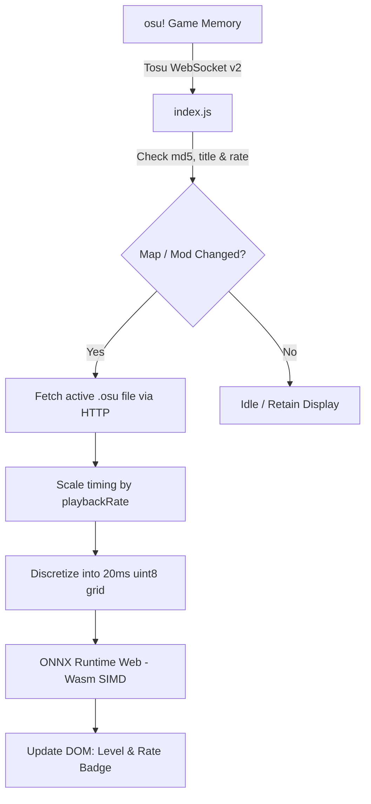

# Tosu Extension & Real-Time In-Game Overlay

## 1. Overview
The **O2Jam 7K Level Predictor** includes an in-game HUD overlay designed for [Tosu](https://github.com/KotRikD/tosu) (the standard open-source osu! memory reader).

It renders a minimal glassmorphic HUD card displaying the predicted O2Jam level, an optional beatmap title line, and an adaptive rate badge. The overlay updates in real-time as you switch maps in song select or gameplay.

---

## 2. Features

- **Fast Local Evaluation:** Runs `model.onnx` entirely in-browser via [ONNX Runtime Web](https://github.com/microsoft/onnxruntime) using SIMD-accelerated WebAssembly (typically ~8–18 ms latency).
- **Minimalist HUD Display:** Renders a clean level rating badge, optional song title, and rate/mod indicator without unnecessary visual clutter.
- **Tosu Native Settings Support:** Fully configurable from the Tosu Web Dashboard via native `settings.json` and `/websocket/commands` bidirectional synchronization (zero overlay refresh required).
- **100% Offline Bundle:** Includes all required `.wasm` and `.js` dependencies locally. No external CDN or internet connection is required.
- **Real-Time Speed & Mod Scaling (DT / HT / Custom):**
  - **Double Time / Nightcore (1.5x DT/NC):** Compresses time intervals by $1.5\times$, evaluating physical note density to predict the accelerated difficulty rating. Displays a `DT` or `NC` badge.
  - **Half Time / Daycore (0.75x HT/DC):** Expands time intervals by $0.75\times$ to reflect lowered density. Displays an `HT` or `DC` badge.
  - **Custom Rates:** Supports osu!lazer fractional rate multipliers (e.g. `1.2x`, `1.4x`).
  - **Note on Extrapolation:** The neural network was trained exclusively on native 1.0x charts. Predictions under DT, HT, or custom rate mods represent model extrapolation based purely on time-scaled note grids rather than empirical rate-specific training labels.
- **Mouse-Transparent In-Game Overlay:** Designed specifically for game overlays (`WS_EX_TRANSPARENT`), allowing players to hit notes without mouse clicks ever stealing focus from the game.

---

## 3. Configuration & Tosu Settings

The overlay supports native Tosu settings configurable through the Tosu Web Dashboard (matching `settings.json`):

| Option | Type | Default | Description |
|---|---|---|---|
| `showSongTitle` | Checkbox | `false` | Display beatmap title and difficulty name |
| `showDecimal` | Checkbox | `false` | Show decimal level precision (e.g. `Lv. 94.2` instead of `Lv. 94`) |
| `hideNon7K` | Checkbox | `false` | Hide the entire overlay when playing non-7K maps |
| `overlayScale` | Number | `1.0` | Scale factor for the overlay widget (0.5 to 2.0) |
| `overlayOpacity` | Number | `0.85` | Opacity factor for the background card (0.1 to 1.0) |
| `accentColor` | Color | `#ffc800` | Accent color for level number and rate badge |

---

## 4. Installation

### Quick Install (ZIP):
1. Download `o2jam_level_predictor.zip` from the Releases page.
2. Extract the archive into your Tosu `static/` directory:
   ```
   tosu/
   ├── static/
   │   └── o2jam_level_predictor/
   │       ├── index.html
   │       ├── index.js
   │       ├── style.css
   │       ├── model.onnx
   │       ├── ort.min.js
   │       ├── settings.json
   │       └── ...
   ```
3. Open or reload your Tosu dashboard / overlay URL:
   ```
   http://127.0.0.1:24050/o2jam_level_predictor/
   ```
4. If using Tosu In-Game Overlay, enable `o2jam_level_predictor` in Tosu overlay manager.

---

## 5. Technical Architecture: WebSocket v2 & WASM Discretization



### Mod & Rate Extraction:
The extension checks both gameplay and song-select states:
- In gameplay state (`state.number === 2` or `status.number === 2`): Prioritizes `gameplay.playbackRate`. If a non-1.0 rate is active, it formats the rate multiplier directly (e.g. `1.2x`).
- Mod fallbacks: Inspects `play.mods`, `gameplay.mods`, or `menu.mods` for mod flags:
  - `NC` / bitflag 512 $\to$ 1.5× rate (`NC`)
  - `DT` / bitflag 64 $\to$ 1.5× rate (`DT`)
  - `DC` $\to$ 0.75× rate (`DC`)
  - `HT` / bitflag 256 $\to$ 0.75× rate (`HT`)
  - Lazer mod settings: parses `speed_change` attributes on rate-altering mods.
- In song select: Prioritizes `menu.mods` to instantly reflect user mod clicks before gameplay starts.

### Temporal Discretization:
Given raw note timestamp $t$ and first note $t_0$, the frame index is scaled directly:
$$\text{frame} = \left\lfloor \frac{t - t_0}{20 \times \text{rate}} \right\rfloor$$
Notes naturally compress together on DT ($1.5\times$), directly exciting the CNN's dilated receptive fields. Because the model was never trained on rate-scaled charts, DT/HT values are purely model extrapolation.
