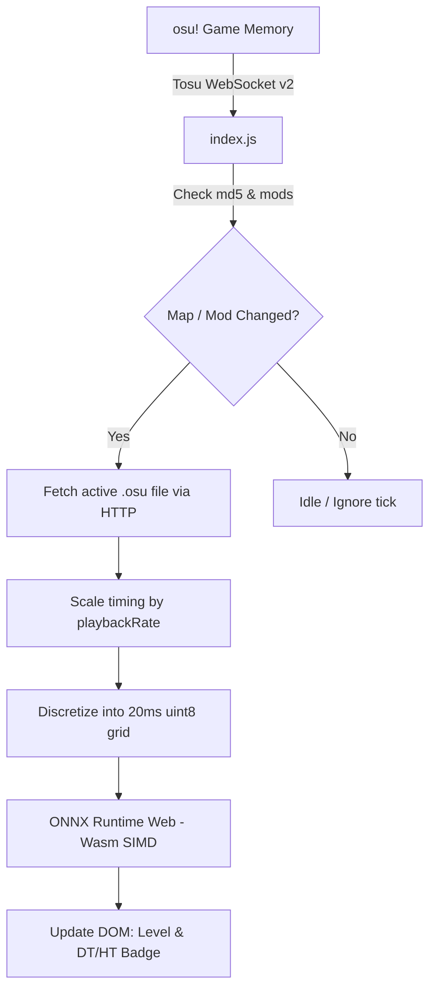

# Tosu Extension & Real-Time In-Game Overlay

## 1. Overview
The **O2Jam 7K Level Predictor** includes an in-game HUD overlay designed for [Tosu](https://github.com/KotRikD/tosu) (the standard open-source osu! memory reader).

It renders a sleek glassmorphic HUD card displaying the predicted O2Jam level and updates in real-time as you switch maps in song select or gameplay.

---

## 2. Features

- **Sub-15ms Live Evaluation:** Runs `model.onnx` entirely in-browser via [ONNX Runtime Web](https://github.com/microsoft/onnxruntime) using SIMD-accelerated WebAssembly.
- **100% Offline Bundle:** Includes all required `.wasm` and `.mjs` binaries locally. No internet connection or external CDN required.
- **Real-Time Speed & Mod Scaling (DT / HT / Custom):**
  - **Double Time / Nightcore (1.5x DT/NC):** Compresses time intervals by $1.5\times$, evaluating physical note density and burst speeds to predict the accelerated difficulty rating. Displays a soft red/rose `DT` badge.
  - **Half Time / Daycore (0.75x HT/DC):** Expands time intervals by $0.75\times$ to reflect lowered density. Displays an emerald green `HT` badge.
  - **Custom Rates:** Supports osu!lazer fractional rate multipliers (e.g. `1.2x`, `1.4x`).
  - **Instant Reset:** Automatically clears badges and restores baseline NoMod ratings when mods are toggled off.
- **Mouse-Transparent In-Game Overlay:** Designed specifically for game overlays (`WS_EX_TRANSPARENT`), allowing players to hit notes without mouse clicks ever stealing focus from the game.

---

## 3. Installation

### Quick Install (ZIP):
1. Download `o2jam_level_predictor.zip` from the Releases page.
2. Extract the archive into your Tosu `static/` directory:
   ```
   tosu/
   ├── static/
   │   └── o2jam_level_predictor/
   │       ├── index.html
   │       ├── index.js
   │       ├── style.css
   │       ├── model.onnx
   │       ├── ort.min.js
   │       └── ...
   ```
3. Open or reload your Tosu dashboard / overlay URL:
   ```
   http://127.0.0.1:24050/o2jam_level_predictor/
   ```
4. If using Tosu In-Game Overlay, enable `o2jam_level_predictor` in Tosu overlay manager.

---

## 4. Technical Architecture: WebSocket v2 & WASM Discretization



### Mod & Rate Extraction:
The extension checks both gameplay and song-select states:
- In gameplay (`state.number == 2`): Reads `gameplay.playbackRate` and `play.mods`.
- In song select: Prioritizes `menu.mods` to instantly reflect user mod clicks.

### Temporal Discretization:
Given raw note timestamp $t$ and first note $t_0$, the frame index is scaled directly:
$$\text{frame} = \left\lfloor \frac{t - t_0}{20 \times \text{rate}} \right\rfloor$$
Notes naturally compress together on DT ($1.5\times$), directly exciting the CNN's dilated receptive fields without requiring custom mod heuristics.
